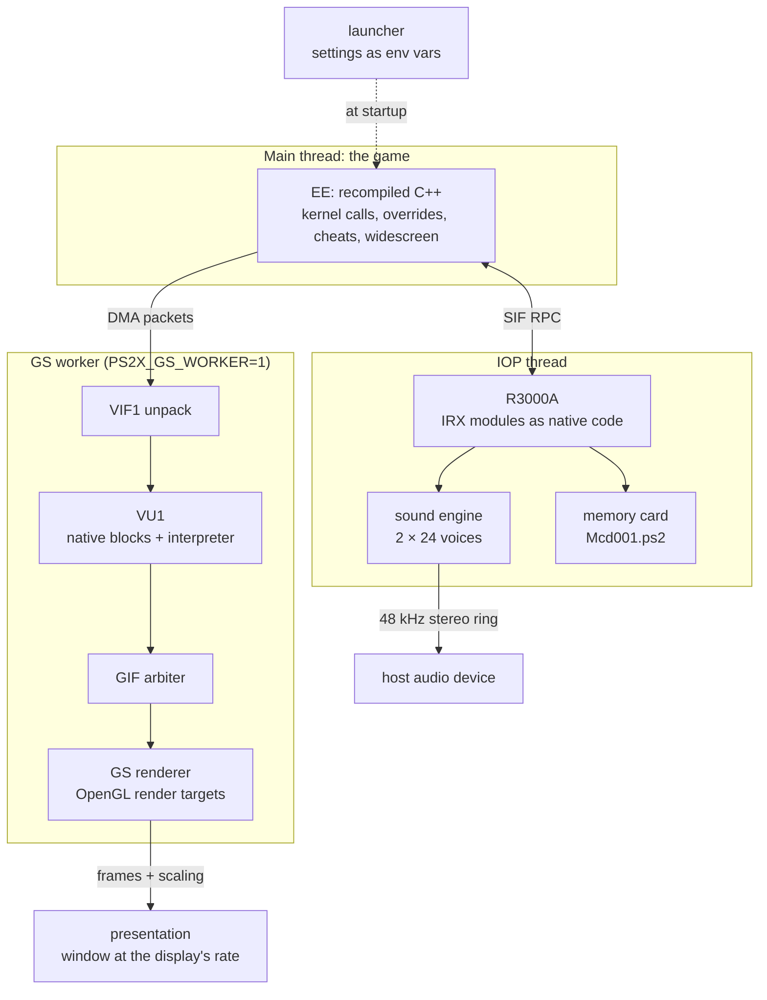

# Architecture

The port has two halves: a **recompiler** that turns the PlayStation 2 executable into C++ (Rust, runs once at install
time) and a **runtime** that the generated C++ runs on (C++, runs every frame). Nothing in the runtime interprets MIPS
for the game's own code; the game is compiled.

The build is a straight pipeline: `ps2-tools` extracts the disc and the VU1 micro-memories, `ps2_recomp` translates
`SCUS_973.99` using `games/scus-97399/` as its configuration, and CMake/Ninja links the generated sources, the runtime
and `src/game/` into `gow-2005`. The interesting part is what happens afterwards, inside one process:

The EE never waits on the GPU unless a read-back requires it; the worker consumes packets as they arrive. The IOP is a
separate CPU with its own clock, advanced from EE cycle grants.

## The recompiler (`RustPortPS2/crates`)

| Crate | Role |
|---|---|
| `ps2-config` | Reads `gow-port.toml`: `stubs`, `skip`, `[mmio]`, `[patches]`, `entry_points` |
| `ps2-elf` | ELF32/MIPS32 loader: sections, symbols, relocations, Ghidra function map |
| `ps2-r5900` | R5900 instruction fields, semantic decode and disassembly (vendored Rabbitizer) |
| `ps2-recomp` | Translators (generic, SPECIAL, REGIMM, COP0/1/2, MMI), control-flow analysis, function emitter, reporters |
| `ps2-recomp-cli` | The `ps2_recomp` binary |
| `ps2-parity` | Byte-for-byte comparison of generated trees against committed manifests |
| `ps2-tools` | Installer helpers: ISO extraction, ELF identity, VU1 manifest/programs, IOP and native-VU1 generators |
| `ps2-devtools` | `ps2-dev`: validators, profile/capture summaries, call lists, test drivers |

The recompiler must stay **byte-identical** to PS2Recomp's C++ recompiler. One rule makes that
possible: no `HashMap` on the emission path, no unordered iteration. `ps2-parity` checks it against a synthetic fixture
in CI and against the retail ELF locally; see [`PARITY.md`](../../RustPortPS2/docs/PARITY.md).

Game-specific inputs live in `RustPortPS2/games/scus-97399/`: `gow-port.toml` (stubs, entry points, MMIO, the 16:9
instruction patch), `funcmap.csv` (6,414 function boundaries), `vu1.manifest` and `vu1-heads.list` (which ELF bytes
form each VU1 micro-memory, and the dynamic entry points). None of it is game code.

## The runtime (`RustPortPS2/native`)

| Target | What it is |
|---|---|
| `ps2xRuntime` | EE context and memory, kernel and syscall services, GS, VU0/VU1, DMA, SIF, audio device, pad, window |
| `ps2xIOP` | R3000A IOP emulator, virtual IOP kernel, native (ahead-of-time) IRX modules |
| `ps2xTest` | Runtime test binary (`PS2X_BUILD_TEST=ON`) |
| `ps2EntryRunner` | The CMake target that links the generated code + runtime + overrides; the file it produces is `gow-2005[.exe]` |

Two kinds of game-specific code are easy to confuse:

- **Kernel stubs** (`src/lib/Kernel/Stubs/`, `ps2xIOP/src/`): the PS2's libraries (`sceGs*`, `sceDma*`, `sceMp3`,
  `scePad2`, `fio`, …) implemented natively. Generic.
- **Game overrides** (`src/game/`, part of the `ps2EntryRunner` target): functions of *this* game replaced by C++.
  `gow_overrides.cpp` binds each address to a module (`gow_pad2.cpp`, `gow_system.cpp`, `gow_display.cpp`,
  `gow_movie.cpp`, `gow_heap_guard.cpp`, `gow_warp.cpp`, `gow_diag_*.cpp`). They declare the generated functions they
  wrap in `gow_guest_functions.h` instead of including the generated headers.

An override must **call the original function for everything it does not replace** and must respect resumptions: if
`ctx->pc` differs from the entry, the call is resuming from a checkpoint and the original runs unchanged.

PC features that the port adds on top of that runtime live in `src/lib/gow_*.cpp` (launcher window, widescreen,
cheats, target lock, agile combat, texture replacement hook, OSD) and are wired by `gow_integration.cpp`.

## Threads

| Thread | Runs |
|---|---|
| Main / EE | The recompiled game code and the syscall/kernel services |
| GS worker (`PS2X_GS_WORKER=1`) | VIF1 unpack, VU1 and GIF processing; the EE only submits packets. This is the shipped configuration |
| Presentation | Scaling and window on the main thread (raylib/OpenGL) |
| IOP | The IOP CPU (interpreter and native modules), with the EE and IOP exchanging SIF packets |
| Optimizer / texture loader / achievements | Launcher-side rebuild, background texture decode and the RetroAchievements client |

## Operating rules

- **Generated files are never edited**: `ps2xRuntime/src/runner/*.cpp`, `ps2xIOP/src/native/iopn_*`,
  `build/*/vu1_generated`, `vu1n_generated`. They are regenerated by the installer.
- Editing a header included by generated code (`ps2_runtime.h`, `ps2_memory.h`, `ps2_perf.h`, the access macros)
  recompiles ~6,400 units. Prefer a `.cpp`; batch CMake edits, because a `CMakeLists.txt` change regenerates the
  precompiled header.
- Every change to code from those upstream projects carries a `// GOW-Port:` comment.
- Rust runs outside the game process; C++ runs inside it.
- Optional diagnostics use an environment variable and a `[gow-...]` tag. See [`ENVIRONMENT.md`](ENVIRONMENT.md).
- Documentation, comments, identifiers, file names and log messages are in English. The only approved translations are
  `README.pt-BR.md`, the launcher and the in-game cheat menu.

## Where a change goes

| Change | Where |
|---|---|
| Recompiler, its configuration model or the tools | `RustPortPS2/crates/` |
| Runtime and IOP | `RustPortPS2/native/` |
| Replacements of game functions, game diagnostics | `RustPortPS2/native/ps2xRuntime/src/game/` |
| PC features (launcher window, widescreen, cheats, lock-on, combat) | `RustPortPS2/native/ps2xRuntime/src/lib/gow_*.cpp` |
| Game data (stubs, patches, function map, VU1 manifests) | `RustPortPS2/games/scus-97399/` |
| Launcher and installation wizard | `gow-launcher/` |
| Installers | `install.sh`, `install.ps1` (with `install.cmd`) |
| Documentation | `docs/` (`docs/dev/` for developers) |

## Tests and gates

| Gate | What it proves |
|---|---|
| `cargo test --workspace` in `RustPortPS2/` | Every crate, the parity fixture, and that the call lists match the committed files |
| `cargo clippy --workspace --all-targets -- -D warnings`, `cargo fmt ... --check` | Lints and formatting (never `cargo fmt --all`: it rewrites the vendored Rabbitizer) |
| `ps2-parity` | Byte-identical generated tree against the committed manifests |
| `ps2-dev validate-config` | `gow-port.toml` and `funcmap.csv` are consistent |
| C++ tests (`ps2xTest`, `PS2X_BUILD_TEST=ON`) | VU1 compiled code, EE/kernel path, pad2 packet, texture replacement, audio simulation |
| `cargo test --workspace` + `npm test` in `gow-launcher/` | Launcher core, interface, kit completeness |

How to run them, and the build options, are in [`BUILD.md`](BUILD.md).
